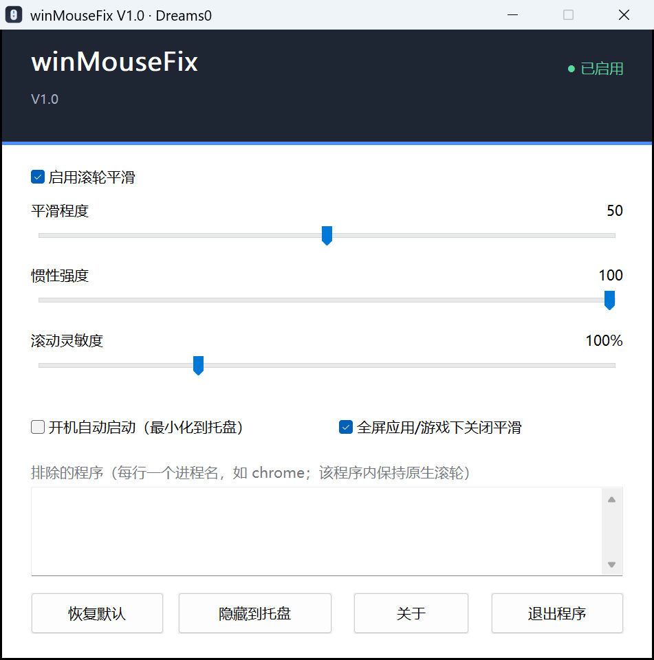

<h1>winMouseFix   让Windows下拥有Macos中的触控板级滑动体验</h1>

<i>A lightweight, speed-aware smooth-scrolling enhancer for Windows.</i>

  
  
  
  
  
  

  

  <a href="#features">✨ 亮点</a>
   · 
  <a href="#quick-start">🚀 快速开始</a>
   · 
  <a href="#settings">🎛️ 设置</a>
   · 
  <a href="#author">👤 作者</a>

---

## ✨ 亮点

> 滚动不该是机械的跳格，而应该像手指在触控板上一样自然。

| 能力               | 体验                                                                         |
| :----------------- | :--------------------------------------------------------------------------- |
| **🎢 速度自适应**  | 慢滚精准停住，快滚自然滑行；滚动速度决定惯性大小。                           |
| **🚀 持续加速**    | 连续快速滚动会逐步提速，最高 +400%；慢下来立即回到精准的 1:1 滚动。          |
| **🎯 智能粒度**    | Chromium / Electron 使用亚格细腻步长，传统程序使用整格输出，顺滑与兼容兼顾。 |
| **↔️ 水平滚轮**  | Shift + 滚轮、倾斜滚轮同样拥有平滑手感。                                     |
| **🖥️ 全屏场景**  | 勾选“全屏应用/游戏下关闭平滑”，全屏时保持系统原生滚动。                    |
| **🧩 排除名单**    | 为特定程序保留原生滚轮手感。                                                 |
| **🔍 Ctrl + 滚轮** | 缩放等原生操作保持原有行为。                                                 |
| **🧭 托盘常驻**    | 托盘运行、开机自启、以管理员身份重启。                                       |

> 智能粒度、水平平滑与持续加速默认开启，开箱即用；只需调整平滑程度与惯性强度，就能找到属于自己的手感。

## 🚀 快速开始

1. 前往 **[Releases](https://github.com/Dreams0/winMouseFix/releases)** 下载 `winMouseFix.exe`。
2. 双击运行，设置窗口出现后滚轮立即生效。
3. 关闭或最小化窗口，程序会留在系统托盘；双击托盘图标可重新打开设置，右键图标可暂停、重启或退出。

从源码构建见下方 [🛠️ 构建](#build)。

## 🎛️ 设置指南

| 设置                        | 说明                                                                  |
| :-------------------------- | :-------------------------------------------------------------------- |
| **启用滚轮平滑**            | 全局开关，关闭后回到系统原生滚轮。                                    |
| **平滑程度**                | 输出曲线的柔顺度。越高越绵密，越低越跟手。                            |
| **惯性强度**                | 快速滚动松手后的滑行距离；0 表示只平滑、不加惯性。                    |
| **滚动灵敏度**              | 每格物理滚轮对应的滚动距离，100% 为系统默认。                         |
| **全屏应用/游戏下关闭平滑** | 勾选后，全屏游戏/视频保持系统原生滚动；取消后全屏场景也使用平滑增强。 |
| **开机自动启动**            | 登录 Windows 后以托盘方式静默启动。                                   |
| **排除的程序**              | 每行一个进程名（如`chrome`、`DingTalk`），该程序内保持原生滚轮。      |

修改即时生效并自动保存；托盘图标与「关于」页面随时可用。

## 🛠️ 构建

**环境**：64 位 MinGW-w64（GCC 13+，C++20，包含 `windres`）。

## 👤 作者

**Dreams0** · [GitHub](https://github.com/Dreams0) · [项目主页](https://github.com/Dreams0/winMouseFix)

应用内点击「关于」可以查看作者与项目链接。

  

## 🗓️ 版本

**V1.0** · 首个公开版本：速度自适应平滑、惯性、持续加速、智能粒度，以及托盘、开机自启与关于页。

## 📄 License

[MIT](LICENSE) © 2026 Dreams0

---

**如果 winMouseFix 让你的滚动更顺手，欢迎 ⭐ Star、分享给朋友，或提交 Issue / PR。**

